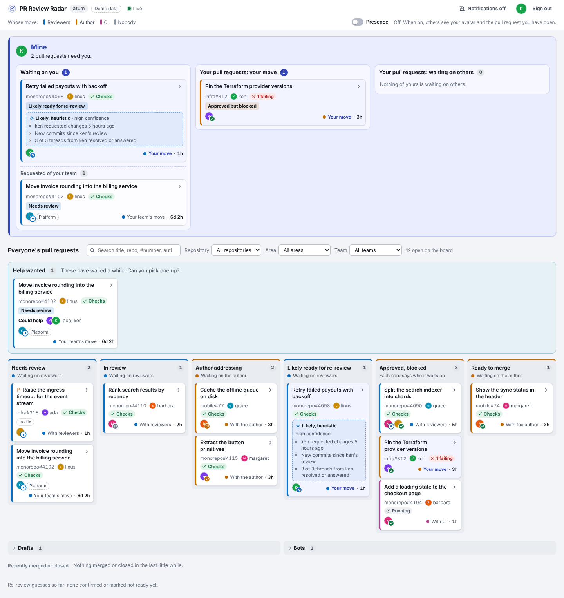

# PR Review Radar

A live, shared board of every open pull request in one GitHub organization. For each pull request, Radar works out whose turn it is and shows that to everyone at once.



Radar exists for one failure that GitHub does not cover. A reviewer requests changes. The author pushes fixes and resolves the threads, but does not click re-request. GitHub then drops the pull request from the reviewer's list, and each side waits for the other. Radar notices the push and the resolved threads, moves the card to "Likely ready for re-review", says why, and puts it in the reviewer's Mine list.

GitHub stays the review tool. Radar does not approve, comment, or merge.

## Read these first

- [`docs/spike.md`](docs/spike.md) compares Radar with `github.com/pulls`, search qualifiers, and Slack reminders, and says what to turn on today whether or not you run Radar.
- [`docs/design.md`](docs/design.md) explains the state rules, the architecture, and the answers to the open questions in the brief.
- [`docs/runbook.md`](docs/runbook.md) covers the GitHub App, its permissions, the Helm install, and how to cut a release.
- [`docs/decisions.tsv`](docs/decisions.tsv) logs each decision made while building it, with the evidence.

## Try it in two minutes

You need Node 22.18 or later. You do not need a GitHub App.

```
npm install
npm run build
RADAR_DEMO=1 npm start
```

Open `http://localhost:8080` and pick a person. The simulated organization has twelve pull requests, one in every state, and it plays a scripted story: an author addresses feedback, a reviewer approves, CI finishes, a pull request merges. Open a second browser window as a different person to see both boards move together.

## What is in the box

| Path | Contents |
|---|---|
| `packages/core` | The domain, with no dependencies and no I/O: `derive` turns one pull request snapshot into a state, a court, the people who need to act, and the reasons. Also card ordering, the Mine filter, the help-wanted rule, and the notification rules. |
| `packages/server` | The GitHub App client, the webhook receiver, the reconcile sweep, the Server-Sent Events hub, sign-in, presence, and the simulated organization. |
| `packages/web` | The React board. |
| `deploy` | The Dockerfile, the Helm chart, and the GitHub App manifest. |
| `scripts/verify-demo.mjs` | An end-to-end check that runs the real server and the built client in several browsers. |
| `scripts/verify-chart.sh` | Lints the chart, renders three configurations, validates them against the Kubernetes schemas, and checks that bad values fail with a readable message. |

The server and the domain run from TypeScript source with Node's type stripping. Only the web client has a build step.

## Check your change

```
npm run typecheck
npm test
npm run check:schema    # validates every GraphQL query against GitHub's public schema
npm run verify:demo     # builds, then drives the real server and client in a browser
npm run verify:chart    # lints and renders the Helm chart; needs helm and kubeconform
```

`npm run verify:demo` needs Chromium for Playwright. Install it once with `npx playwright install chromium`.

## What Radar will not do

- It makes no write to GitHub except a re-request of review that the author starts, and that one is off until you grant the permission.
- It keeps no per-person numbers and no history of states. The server stores the current state of each open pull request, the author's "ready" or "not ready" signal, and two anonymous totals for the heuristic.
- It sends no notification and shares no presence until the user turns each one on.

## Status

Radar has not run against a real organization yet. The state rules, the pipeline, and the client are verified against the simulated organization and unit tests. [`docs/design.md`](docs/design.md#what-stays-unproven) lists what is still unproven.
